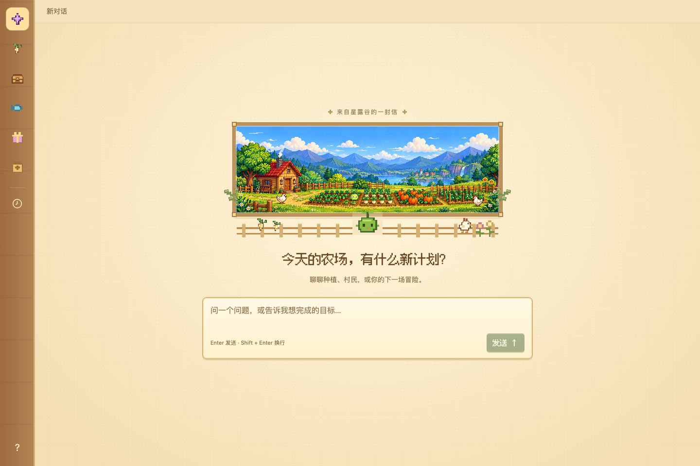
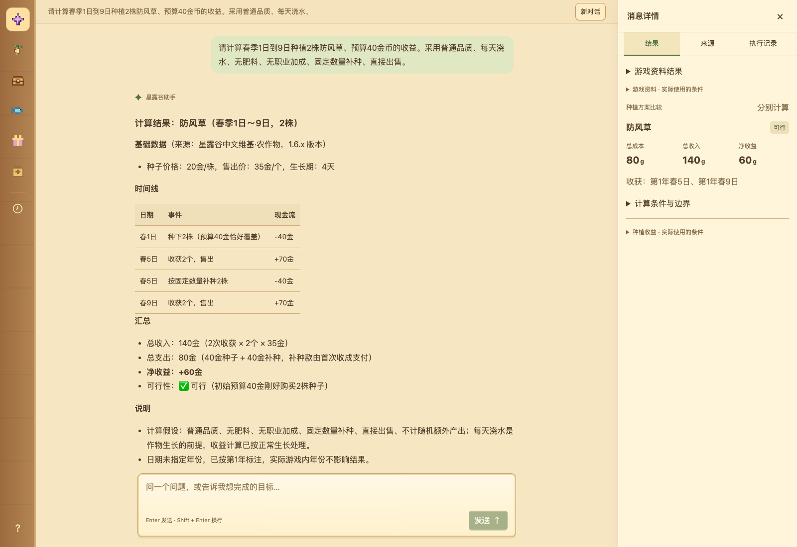
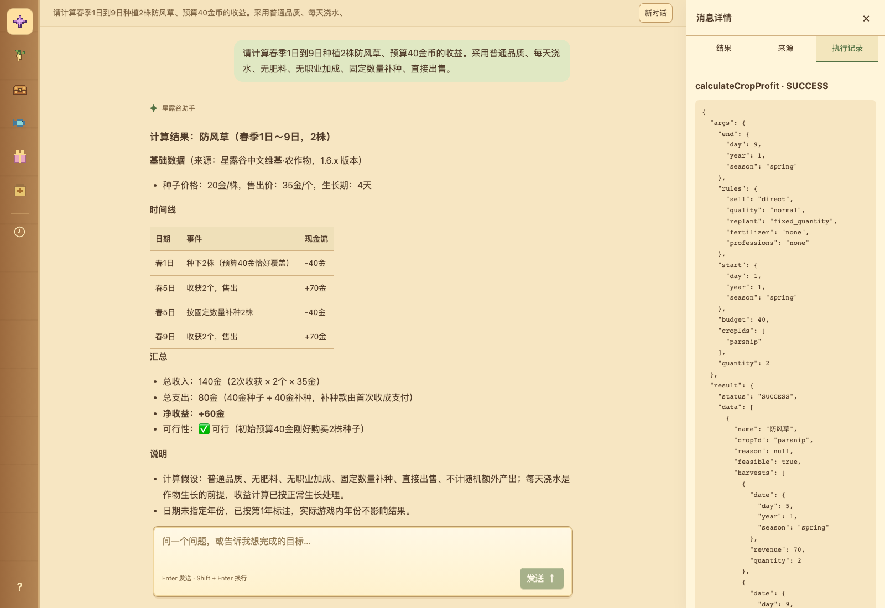
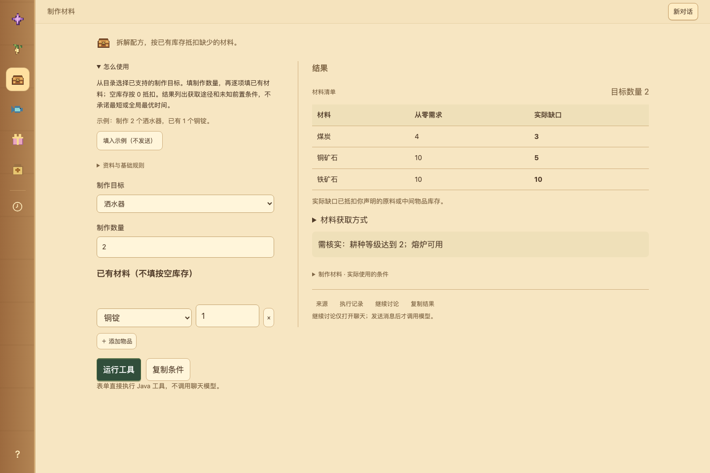
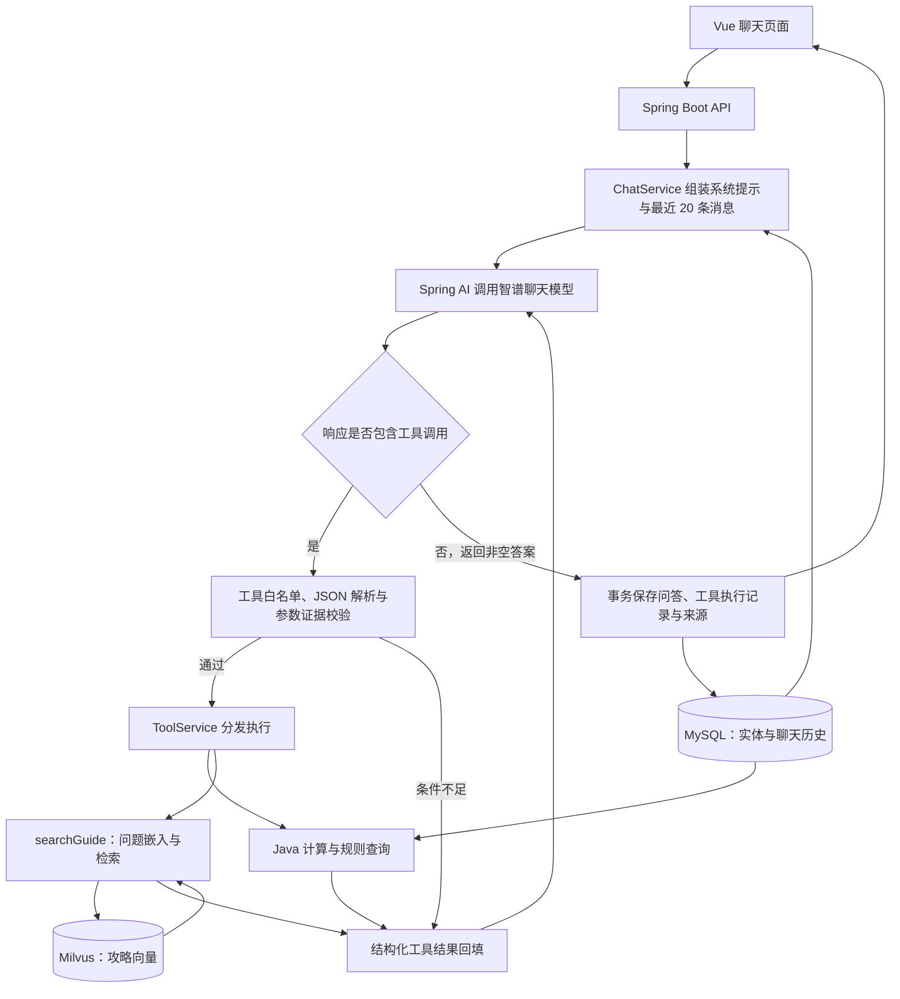

# 星露谷助手 · Valley Companion

**基于 Spring AI 的星露谷领域工具调用 Agent**，覆盖自然语言问答、攻略检索、种植收益计算、制作材料展开、钓鱼筛选、送礼查询和献祭缺项分析。

项目围绕一个具体问题展开：游戏问答既需要解释攻略，也需要准确处理日期、价格、预算和库存。模型负责理解问题、选择工具和组织回答，Java 业务工具负责计算与规则查询，MySQL 和 Milvus 分别提供结构化资料与攻略检索。页面同步展示答案、实际工具参数、结果与资料来源。

当前资料集收录 **322 个游戏实体、169 条攻略**，对应星露谷 **1.6.x 中已收录并核验的规则**。项目适合从 Java 后端与 AI 应用开发的视角，讨论工具调用编排、RAG、上下文管理和异常处理。

## 项目预览

以下截图来自本机部署的实际页面。Agent 对话与执行记录展示已保存的真实模型请求，材料工具展示直接调用 Java 业务工具的结果。

**首页：像素农场风格的聊天入口。**



**Agent 对话：自然语言问题、模型解释与结构化计算结果同时展示。**



<details>
<summary>查看更多：实际工具执行记录与材料工具</summary>

**执行记录：查看实际调用的工具、参数、状态与结构化返回值。**



**材料工具：填写制作目标与已有库存，递归展开原料需求并计算缺口。**



</details>

## 技术栈

| 层次 | 技术与职责 |
| --- | --- |
| 后端 | Java 17、Spring Boot 3.5.8：HTTP API、Agent 循环、业务工具与事务 |
| 模型接入 | Spring AI 1.1.2、智谱聊天与嵌入模型：工具定义、消息协议、模型请求 |
| 关系存储 | MyBatis Spring Boot Starter 3.0.5、MySQL 8.4、Flyway：游戏实体、别名、聊天历史与导入状态 |
| 向量检索 | Milvus 2.5.10：攻略向量存储、主题筛选与相似度检索 |
| 前端 | Vue 3、TypeScript、Vite：聊天、工具表单、结果卡片与来源展示 |
| 交付与验证 | Docker Compose、JUnit、Testcontainers、Vitest、Playwright、GitHub Actions |

## Agent 如何工作

Agent 采用单 Agent、同步的多轮工具调用模式。每次模型响应可以直接给出答案，也可以请求工具；应用执行工具后，将结构化结果回填给模型，由模型决定下一步。



### 1. 应用显式管理工具调用循环

[ChatService](backend/src/main/java/dev/stardew/assistant/conversation/ChatService.java) 管理模型交互与工具执行。[模型网关](backend/src/main/java/dev/stardew/assistant/ai/ZhipuModelGateway.java) 设置 `internalToolExecutionEnabled(false)`，由应用检查并执行模型返回的工具调用。

一次请求的主要步骤：

1. 校验会话与输入，获取该会话的进程内互斥标记。
2. 从 MySQL 读取最近 20 条消息，附带历史轮次保存的工具数据，组装模型上下文。
3. 向模型提供工具名称、说明与 JSON Schema，接收答案或工具调用。
4. 检查工具白名单、解析参数，对指定业务字段执行输入证据校验，再分发到业务工具。
5. 将每次工具结果封装为 `ToolResponseMessage` 回填，继续模型交互。
6. 得到最终答案后，事务保存用户消息、助手消息、工具记录与来源，返回前端。

应用限制每次请求最多 **8 轮模型交互、12 次工具执行**，并在循环与外部请求中传递 **120 秒总处理预算**；超限或超时返回明确错误。模型请求配置为单次尝试，失败不自动重试。

### 2. 8 个领域工具，聊天与表单共用业务逻辑

工具协议集中定义在 [tools.json](backend/src/main/resources/tools.json)，由 [ToolService](backend/src/main/java/dev/stardew/assistant/tools/ToolService.java) 分发。模型从已注册工具中选择调用，5 个业务工具同时支持页面表单直接调用。

| 工具 | 能力 | 执行方式 |
| --- | --- | --- |
| `queryGameData` | 按名称、别名或 ID 查询实体，返回稳定 ID 和来源 | 本地结构化资料查询 |
| `listCrops` | 列出全部或指定季节的已收录作物 | 本地结构化资料查询 |
| `searchGuide` | 按问题检索攻略，可按主题筛选 | 嵌入模型 + Milvus |
| `calculateCropProfit` | 计算收获日期、成本、收入与净收益 | Java 规则计算；支持表单 |
| `expandMaterialRequirements` | 递归展开制作材料并抵扣库存 | Java 递归展开；支持表单 |
| `findFish` | 按季节、天气、地点和时间筛选鱼类 | Java 条件匹配；支持表单 |
| `queryGiftPreferences` | 查询村民礼物偏好，处理个人例外 | Java 规则查询；支持表单 |
| `getBundleMissing` | 区分已提交与背包物品，核算献祭缺项 | Java 规则计算；支持表单 |

表单路径直接调用同一业务执行层，结果也保存到会话中，后续可以继续通过聊天讨论。资料导入完成后，这 5 类表单操作本身不调用聊天或嵌入模型。

### 3. 对关键参数核对用户输入证据

工具 Schema 描述输入结构；业务层继续检查类型、范围和规则。对于模型可能补造的日期、数量、预算等条件，[ToolInputGuard](backend/src/main/java/dev/stardew/assistant/ai/ToolInputGuard.java) 结合最近对话和已提交表单检查输入证据：

- 作物计算核对数量、预算、起止日期；材料展开核对制作数量。
- 对材料库存声明、献祭可用金币、已提交物品与背包声明执行相应检查。
- 识别到话题切换或“重新开始”等表达时，清理相关历史条件，减少跨问题误用。
- 条件缺失或不一致时返回 `NEEDS_INPUT`，将结果回填给模型，引导其追问。

这是一套基于规则的、覆盖部分工具与字段的校验。库存声明检查等并不等同于逐项验证所有数值，最终回答也没有完整的自动事实校验。

### 4. 将 RAG 放进工具体系，计算交给业务代码

Agent 可按问题选择 `searchGuide`，也可调用实体查询或计算工具。攻略检索链路为“问题嵌入 → Milvus 向量查询 → 主题与分数筛选 → 返回最多 5 条片段及来源”。当前实现为纯向量检索，默认最低相似度阈值为 `0.35`。

结构化计算结果与检索结果统一使用 `ToolResult`，包含 `status`、`data`、`sources`、`assumptions`、`errorCode`。其中 `NEEDS_INPUT`、`NO_DATA`、`UNSUPPORTED` 分别表达条件不足、当前资料无匹配和规则范围不支持，让模型与页面可以区分业务状态。

资料导入时检查数量、重复 ID 与来源元数据；根据资料内容哈希、嵌入模型、维度和索引数量判断是否跳过重复导入。检索前检查嵌入配置与导入元数据是否匹配，避免使用不匹配的向量索引。

### 5. 保留执行证据，控制会话一致性

成功完成一轮问答后，MySQL 事务一次性保存用户消息、助手回答、实际工具名称与参数、结构化结果及去重后的来源。刷新页面可以恢复已完成历史，面试演示时也能核对模型实际调用了什么。

同一会话通过进程内集合限制为一个处理中请求，重复请求返回 HTTP 409；异常不保存半轮消息。模型请求与工具执行发生在保存事务之前，事务覆盖最终落库过程。项目面向本机单实例，未实现分布式会话锁。

## 一个可复核的 Agent 演示

输入：

> 第 1 年春季 1 日到 9 日，种植 2 株防风草，初始预算 40 金币，收益多少？

以下是用于解释实现的示意调用链，实际调用顺序和次数由模型决定：

```text
用户问题
  → queryGameData：确认防风草实体、ID 与规则
  → calculateCropProfit：传入作物 ID、日期、数量和预算
  → Java 返回收获事件、成本、收入、净收益与来源
  → 模型解释结果，前端展示答案和工具结果卡片
```

按当前资料与默认规则，防风草种子单价 20、成熟需 4 天、普通品质售价 35。2 株在春季 5 日首次收获后，用所得现金补种，春季 9 日再次收获：

| 项目 | 结果 |
| --- | --- |
| 初始预算 | 40 金币 |
| 收获日期 | 春季 5 日、春季 9 日 |
| 两次种植总成本 | 80 金币 |
| 两次收获总收入 | 140 金币 |
| 净收益 | 60 金币 |

初始预算用于现金流约束，总成本包含收获后补种的支出。

再尝试省略预算：“第 1 年春季 1 日到 9 日种植 2 株防风草，收益多少？”模型应追问预算；如果模型直接猜测预算调用计算工具，参数证据校验会返回 `NEEDS_INPUT`。补充“初始预算 40 金币”后，可继续计算。

[验证记录](docs/verification.md) 已记录真实供应商下普通聊天、攻略检索和防风草收益工具调用成功。以上流程用于讲解调用机制；少量真实请求验证不能代表完整模型质量评测。

## 快速启动

### Docker 运行

需要 Docker Desktop，或已安装 Docker Compose 插件的 Docker Engine。首次构建需要联网下载镜像及 Maven/npm 依赖；使用 Docker 运行无需本机安装 Java 和 Node.js。

```sh
git clone https://github.com/02Ayanami/stardew-assistant.git
cd stardew-assistant
test -f .env || cp .env.example .env
```

在 `.env` 中填写 `ZHIPU_API_KEY`，确认账户能够使用配置的聊天和嵌入模型，再运行：

```sh
./scripts/import.sh
```

脚本启动 MySQL 与 Milvus、构建后端、导入游戏实体和攻略向量，最后启动前后端。**首次导入调用真实嵌入 API，会消耗供应商额度。** 导入失败后修正配置，重新执行同一命令。

| 入口 | 默认地址 |
| --- | --- |
| 页面 | <http://127.0.0.1:8081> |
| API 健康检查 | <http://127.0.0.1:9911/api/health> |
| 资料与模型配置状态 | <http://127.0.0.1:8081/api/status> |

通过 `/api/status` 检查资料状态为 `READY`、实体数为 322、攻略数为 169。`/api/health` 只表示 HTTP 服务可用，`modelConfigured` 只表示密钥非空，均不能证明供应商请求成功。

```sh
# 后续启动：不自动导入资料或调用模型
./scripts/start.sh

# 停止并移除容器，保留数据卷
./scripts/stop.sh
```

资料、嵌入模型或维度改变后，重新运行 `./scripts/import.sh`。脚本先停止应用，再导入并重建当前项目索引；资料与配置未变且索引数量匹配时跳过嵌入调用。历史消息保留当时的工具结果，新问题使用当前资料。

### 主要配置

完整示例见 [.env.example](.env.example)。密钥只由后端使用，`.env` 已被 Git 忽略。

| 配置 | 默认值 | 用途 |
| --- | --- | --- |
| `ZHIPU_API_KEY` | 空 | 智谱 API 密钥 |
| `CHAT_MODEL` | `glm-5.3-flash` | 聊天模型，以账户实际可用模型为准 |
| `EMBEDDING_MODEL` / `EMBEDDING_DIMENSION` | `embedding-3` / `1024` | 嵌入模型及维度，变更后重新导入 |
| `RETRIEVAL_MIN_SCORE` | `0.35` | 攻略检索最低相似度 |
| `DOCKER_WEB_PORT` / `DOCKER_API_PORT` | `8081` / `9911` | Docker 页面及 API 的宿主机端口 |
| `MYSQL_PORT` / `MILVUS_PORT` / `MILVUS_HEALTH_PORT` | `3307` / `19531` / `19092` | 数据服务宿主机端口 |
| `DATABASE_PASSWORD` / `MYSQL_ROOT_PASSWORD` | 见示例文件 | 本地 MySQL 初始化密码 |

Compose 项目名为 `stardew-assistant-simple`，使用独立命名的数据卷。Milvus 所需的 etcd、MinIO 由 Compose 一并管理。端口修改后，访问地址需同步调整，脚本打印的地址仍是默认值；已有 MySQL 数据卷的密码不会随初始化环境变量自动改变。

### 本机开发

需要 Java 17、Node.js 24 和 Docker。先按上面的流程完成资料导入，然后在仓库根目录停止应用容器，保留数据服务运行：

```sh
docker compose stop backend frontend
```

分别在两个终端执行：

```sh
cd backend
./mvnw spring-boot:run
```

```sh
cd frontend
npm ci
npm run dev
```

开发页面为 <http://127.0.0.1:5174>。后端从仓库根目录 `.env` 读取配置，默认连接 MySQL `3307`、Milvus `19531`。如修改数据服务端口，需在 `.env` 中设置对应的 `DATABASE_URL` / `MILVUS_URI`；本机后端端口通过 `PORT` 设置，开发前端通过环境变量 `FRONTEND_PORT`、`API_TARGET` 设置端口与代理目标。

未配置密钥时可以启动页面与 API；聊天、攻略检索和首次资料导入需要相应模型配置。

## 验证方式

```sh
# 单元测试与前端构建，不需要真实模型密钥
(cd backend && ./mvnw test)
(cd frontend && npm ci && npm test -- --run && npm run build)

# 首次运行浏览器测试前安装 Chromium
(cd frontend && npx playwright install chromium)

# 真实 MySQL / Milvus 集成测试，以及浏览器端到端测试
./scripts/verify.sh
```

完整验证需要 Java 17、Node.js 24 和 Docker。后端集成测试及浏览器测试通过 Testcontainers 使用临时 MySQL，向量测试使用当前项目 Milvus 的独立测试 collection。聊天和嵌入模型使用仅位于测试源码中的替身，不消耗真实模型额度，也不进入生产 jar。

现有[验证记录](docs/verification.md)记载 50 项后端单元测试、5 项集成测试、8 项前端单元测试及 8 项浏览器测试通过，覆盖业务规则、工具调用与参数约束、资料导入、聊天历史、表单和异常交互。GitHub Actions 在 push / pull request 时执行后端、前端和浏览器验证。自动化通过用于证明工程链路与已测试行为，真实语义检索和生成质量需另行评估。

## 代码阅读与面试讨论入口

| 关注点 | 代码或文档 |
| --- | --- |
| Agent 循环、执行预算、历史与落库 | [conversation](backend/src/main/java/dev/stardew/assistant/conversation/) |
| 模型接入、工具 Schema、参数证据校验 | [ai](backend/src/main/java/dev/stardew/assistant/ai/)、[工具协议](backend/src/main/resources/tools.json) |
| 工具分发与结构化返回 | [tools](backend/src/main/java/dev/stardew/assistant/tools/)、[common](backend/src/main/java/dev/stardew/assistant/common/) |
| 作物计算、材料递归与其他领域规则 | [crop](backend/src/main/java/dev/stardew/assistant/crop/)、[material](backend/src/main/java/dev/stardew/assistant/material/)、[domain](backend/src/main/java/dev/stardew/assistant/domain/) |
| 向量检索、导入一致性与持久化 | [knowledge](backend/src/main/java/dev/stardew/assistant/knowledge/)、[data](backend/src/main/java/dev/stardew/assistant/data/)、[Mapper XML](backend/src/main/resources/mapper/) |
| API 与学习路线 | [接口说明](docs/api.md)、[新手阅读路线](docs/learning.md)、[验证记录](docs/verification.md) |

可以沿代码讨论：为什么显式管理工具循环、如何处理模型猜测参数、如何区分检索与计算、如何限制调用成本、为什么最后才开启保存事务，以及测试替身能验证和不能验证哪些能力。

## 当前实现边界

- **Agent**：单 Agent 同步工具调用；没有独立规划器、多 Agent 协作、后台任务、SSE 或完整路线自动校验。
- **上下文**：最近 20 条消息及其中保存的工具数据；没有长期记忆检索或历史资料版本切换。
- **检索**：纯向量检索，受收录范围、嵌入质量与阈值影响；无关键词检索、混合检索或重排。相似度不代表结论正确。
- **种植**：普通品质、每天浇水、无肥料和职业加成、固定数量补种、直接出售；各作物独立比较。
- **材料与其他规则**：按已收录路线展开，不保证全局最优；钓鱼不覆盖特殊鱼饵与 Mod，送礼不计算好感度，献祭限单个普通收集包、不跨包分配。
- **可靠性**：参数证据校验覆盖部分字段，模型仍可能错误解释工具结果；无自动重试。连接中断后应先检查历史，再决定是否重新提交。
- **部署**：本机单人单实例，无账户系统或分布式锁，Compose 默认仅绑定本机地址。

## 资料与资源说明

游戏资料保留来源元数据，见 [data/game](data/game/)；其中部分快照标识和采集路径来自参考资料，不能视为本仓库具备历史快照切换能力，原始采集回执也未全部包含在仓库中。运行依赖均在当前项目内，不需要启动参考项目。

视觉资源说明见 [art/README](frontend/public/art/README.md)，字体许可保留在 [fonts](frontend/public/fonts/) 中。本项目为非官方学习与演示项目，与游戏官方无隶属关系。
